<div align="center">
  <a href="https://git.io/typing-svg">
    
  </a>
</div>

<!-- A preferência de movimento é aplicada no HTML para manter os SVGs animados compatíveis com imagens no GitHub. -->
<p align="center">
  <picture>
    <source media="(prefers-reduced-motion: reduce)" srcset="assets/static/terminal.svg" />
    
  </picture>
</p>

<p align="center">
  <a href="https://www.instagram.com/daniel_santana_dev/">
    
  </a>
  <a href="https://www.linkedin.com/in/daniel-santana-8a1454384/">
    
  </a>
</p>

<p align="center">
  <samp>Campo Grande MS, Brasil · pronto para novos desafios.</samp>
</p>

<br />

<h2 id="sobre-mim">
  <picture>
    <source media="(prefers-reduced-motion: reduce)" srcset="assets/static/h-sobre.svg" />
    
  </picture>
</h2>

Sou **Daniel Santana**, de **Campo Grande MS, Brasil**. Meu foco é **Full-Stack**, **Inteligência Artificial** e **Motion** — desenvolvimento, tecnologia e criatividade no mesmo lugar.

- 🖥️ Técnico em Desenvolvimento de Sistemas (85%)
- 🎓 Engenharia de Software (6º/7º semestre)
- 🚀 Vamos pra Cima!

<p align="center">
  <picture>
    <source media="(prefers-reduced-motion: reduce)" srcset="assets/static/editor.svg" />
    
  </picture>
</p>

<br />

<h2 id="skills">
  <picture>
    <source media="(prefers-reduced-motion: reduce)" srcset="assets/static/h-skills.svg" />
    
  </picture>
</h2>

<p align="center">
  
</p>

<br />

<h2 id="estatisticas">
  <picture>
    <source media="(prefers-reduced-motion: reduce)" srcset="assets/static/h-estatisticas.svg" />
    
  </picture>
</h2>

<p align="center">
  
</p>

<br />

<h2 id="objetivos">
  <picture>
    <source media="(prefers-reduced-motion: reduce)" srcset="assets/static/h-objetivos.svg" />
    
  </picture>
</h2>

```diff
+ Aprender novas tecnologias constantemente
+ Participar de projetos Open Source
+ Desenvolver novas soluções
+ Pronto para novos desafios
```

<br />

<h2 id="contribuicoes">
  <picture>
    <source media="(prefers-reduced-motion: reduce)" srcset="assets/static/h-contribuicoes.svg" />
    
  </picture>
</h2>

<picture>
  <source media="(prefers-color-scheme: dark)" srcset="https://raw.githubusercontent.com/DanielSantana7890/DanielSantana7890/output/github-contribution-grid-snake-dark.svg" />
  <source media="(prefers-color-scheme: light)" srcset="https://raw.githubusercontent.com/DanielSantana7890/DanielSantana7890/output/github-contribution-grid-snake-dark.svg" />
  
</picture>

<br />

<p align="center">
  <picture>
    <source media="(prefers-reduced-motion: reduce)" srcset="assets/static/rodape.svg" />
    
  </picture>
</p>
