<div align="center">
  <a href="https://git.io/typing-svg">
    
  </a>
</div>

<!-- A preferência de movimento é aplicada no HTML para manter os SVGs animados compatíveis com imagens no GitHub. -->
<p align="center">
  <a href="https://github.com/DanielSantana7890/DanielSantana7890/tree/main/assets/terminal.svg">
    <picture>
      <source media="(prefers-reduced-motion: reduce)" srcset="assets/static/terminal.svg" />
      
    </picture>
  </a>
</p>

<p align="center">
  <a href="https://www.instagram.com/daniel_santana_dev/">
    
  </a>
  <a href="https://www.linkedin.com/in/daniel-santana-8a1454384/">
    
  </a>
</p>

<br />

<h2 id="sobre-mim">
  <a href="https://github.com/DanielSantana7890/DanielSantana7890/tree/main/assets/h-sobre.svg">
    <picture>
      <source media="(prefers-reduced-motion: reduce)" srcset="assets/static/h-sobre.svg" />
      
    </picture>
  </a>
</h2>

<picture>
  <source media="(prefers-reduced-motion: reduce)" srcset="assets/static/editor.svg" />
  
</picture>

<picture>
  <source media="(prefers-reduced-motion: reduce)" srcset="assets/static/intro.svg" />
  
</picture>

<br />

<div align="justify">

Sou **Daniel Santana**, de **Campo Grande MS, Brasil**. Foco em `Full-Stack`, `Inteligência Artificial` e `Motion`.

Formação: **Técnico em Desenvolvimento de Sistemas** e **Engenharia de Software**.
Busco desafios e colaborações. **Vamos pra Cima!** 🚀

</div>

<br clear="right" />

```diff
+ Full-Stack, Inteligência Artificial e Motion
+ Aprendendo novas tecnologias e criando soluções
+ Pronto para novos desafios e colaborações
```

<br />

<h2 id="skills">
  <a href="https://github.com/DanielSantana7890/DanielSantana7890/tree/main/assets/h-skills.svg">
    <picture>
      <source media="(prefers-reduced-motion: reduce)" srcset="assets/static/h-skills.svg" />
      
    </picture>
  </a>
</h2>

<p align="center">
  
</p>

<br />

<h2 id="estatisticas">
  <a href="https://github.com/DanielSantana7890/DanielSantana7890/tree/main/assets/h-estatisticas.svg">
    <picture>
      <source media="(prefers-reduced-motion: reduce)" srcset="assets/static/h-estatisticas.svg" />
      
    </picture>
  </a>
</h2>

<p align="center">
  
</p>

<br />

<h2 id="objetivos">
  <a href="https://github.com/DanielSantana7890/DanielSantana7890/tree/main/assets/h-objetivos.svg">
    <picture>
      <source media="(prefers-reduced-motion: reduce)" srcset="assets/static/h-objetivos.svg" />
      
    </picture>
  </a>
</h2>

```diff
+ Aprender novas tecnologias constantemente
+ Participar de projetos Open Source
+ Desenvolver novas soluções
+ Pronto para novos desafios
```

<br />

<h2 id="contribuicoes">
  <a href="https://github.com/DanielSantana7890/DanielSantana7890/tree/main/assets/h-contribuicoes.svg">
    <picture>
      <source media="(prefers-reduced-motion: reduce)" srcset="assets/static/h-contribuicoes.svg" />
      
    </picture>
  </a>
</h2>

<picture>
  <source media="(prefers-color-scheme: dark)" srcset="https://raw.githubusercontent.com/DanielSantana7890/DanielSantana7890/output/github-contribution-grid-snake-dark.svg" />
  <source media="(prefers-color-scheme: light)" srcset="https://raw.githubusercontent.com/DanielSantana7890/DanielSantana7890/output/github-contribution-grid-snake-dark.svg" />
  
</picture>

<br />

<p align="center">
  <a href="https://github.com/DanielSantana7890/DanielSantana7890/tree/main/assets/rodape.svg">
    <picture>
      <source media="(prefers-reduced-motion: reduce)" srcset="assets/static/rodape.svg" />
      
    </picture>
  </a>
</p>
