  

---

<h2 id="sobre-mim">
  
</h2>

- 🖥️ Técnico em Desenvolvimento de Sistemas (85%)
- 🎓 Engenharia de Software (6º/7º semestre)
- 🚀 Vamos pra Cima!

 
 

---

<h2 id="skills">
  
</h2>

  
  
   
  
       
   
   
  

---

<h2 id="estatisticas">
  
</h2>

  

---

<h2 id="objetivos">
  
</h2>

- 📚 Aprender novas tecnologias constantemente
- 🤝 Participar de projetos Open Source
- 💡 Desenvolver novas soluções

---

<h2 id="contribuicoes">
  
</h2>

<picture align="center">
  <source media="(prefers-color-scheme: dark)" srcset="https://raw.githubusercontent.com/DanielSantana7890/DanielSantana7890/output/github-contribution-grid-snake-dark.svg">
  <source media="(prefers-color-scheme: light)" srcset="https://raw.githubusercontent.com/DanielSantana7890/DanielSantana7890/output/github-contribution-grid-snake-dark.svg">
  
</picture>

